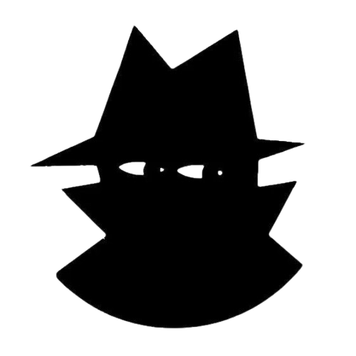
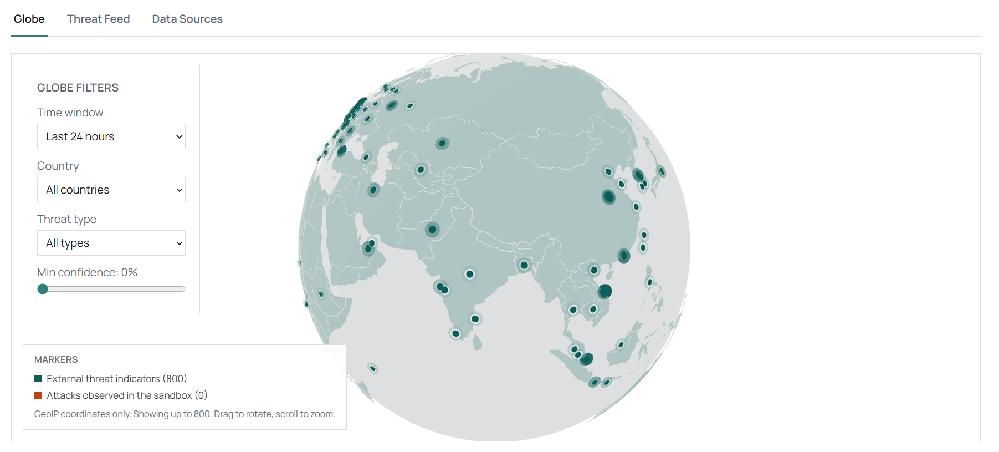
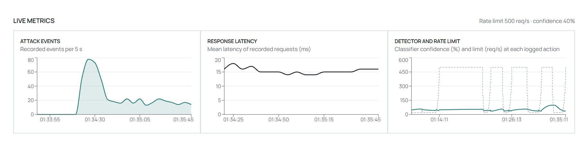
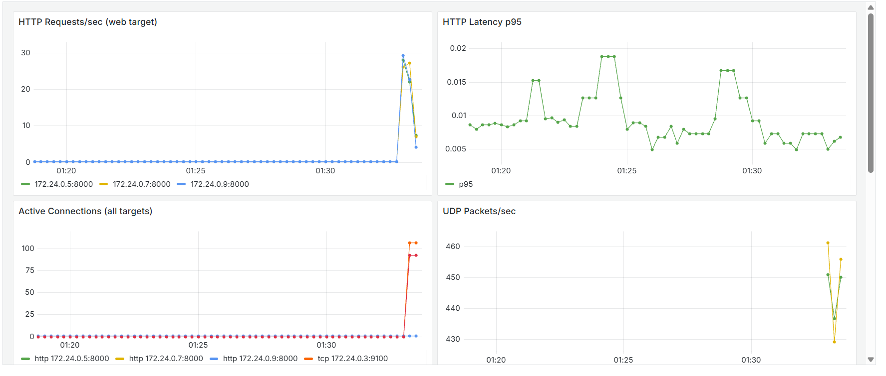

<p align="center"></p>

<h1 align="center">Adytum</h1>

<p align="center">
A self-contained DDoS simulation, detection and threat-intelligence lab for security research and learning.<br>
Everything runs in Docker, on isolated networks.
</p>

<p align="center">


</p>

> **Safety:** the attacker and target networks are Docker `internal` networks, so attack traffic cannot reach external hosts. Never publish the lab's ports beyond your own machine.

## Overview

Simulated attacks hit an isolated target network. An Isolation Forest detector and Suricata flag them, an adaptive rate limiter mitigates HTTP floods, and a dashboard shows the results next to live public threat-intelligence data.

## Key features

| Area | Details |
|---|---|
| Attack simulation | HTTP flood, Slowloris, UDP flood, TCP exhaustion, plus a legitimate-load control |
| Detection | Isolation Forest on live traffic features; four Suricata sensors with calibrated rules |
| Mitigation | Adaptive, per-source-fair rate limiter. **HTTP only**: UDP, TCP and Slowloris are detected, not mitigated |
| Incidents | Suricata alerts, ML detections and Prometheus metrics correlated into incidents (advisory only) |
| Threat intelligence | Public feeds normalised into PostgreSQL, served over REST and WebSocket, geolocated with MaxMind GeoLite2 |
| Dashboard | Overview, Global Threat Intelligence (3D globe, feed, sources), Sandbox Lab, Analytics, Alerts, Settings |
| Observability | Prometheus and Grafana |

## Architecture

```text
attacker_net (internal)          target_net (internal)                  public_net
 attacker-* containers  ──►  rate-limiter ──► lb ──► web x3      Grafana, globe API, dashboard,
                                  │            tcp-service x2    threat-intel, defense-engine
                                  │            dns-udp x2
                     defense-engine (ML + mitigation policy)
                     Suricata: ingress + 3 target taps
                     Prometheus

threatintel_net: threat-intel ── PostgreSQL ── Redis   (outbound HTTPS for feeds)
```

`defense-engine` is the single read-only link between the lab and threat intelligence.

## Tech stack

| Layer | Technologies |
|---|---|
| Backend | Python, FastAPI |
| Frontend | React, TypeScript, Tailwind CSS, Recharts, Three.js / React Three Fiber |
| Security | Isolation Forest, Suricata |
| Data | PostgreSQL, Redis |
| Monitoring | Prometheus, Grafana |
| Infrastructure | Docker Compose (Kubernetes and Terraform files are unverified) |

## Dashboard

<p align="center">
<br>
<sub><b>Global Threat Intelligence:</b> interactive 3D globe of GeoIP-located threat indicators, with filters.</sub>
</p>

<p align="center">
<br>
<sub><b>Sandbox Lab:</b> start and stop each attack scenario and the legitimate-load control.</sub>
</p>

<p align="center">
<br>
<sub><b>Live metrics:</b> attack events, response latency, and detector confidence against the rate limit.</sub>
</p>

<p align="center">
<br>
<sub><b>Grafana:</b> request rate, latency, connections and UDP packets, embedded in Sandbox Lab.</sub>
</p>

## Research results

All figures come from the isolated lab with synthetic traffic, at one legitimate load level (about 9 req/s, 20 simulated users) and one run per scenario. Treat them as lab measurements, not general benchmarks.

**Detector** (selected model, offline evaluation on 125 five-second samples: 63 normal, 62 attack)

| Precision | Recall | False-positive rate | F1 |
|---|---|---|---|
| 92.5% | 100% | 7.9% (5 of 63 normal samples) | 96.1% |

**Mitigation** (default configuration: fair limiter, guarded policy, candidate model)

| Scenario | Flood admitted (req/s) | Flood blocked | Legitimate client blocked |
|---|---|---|---|
| Legitimate alone | n/a | n/a | 0 of 844 |
| Single-source flood | 64 | 91.4% | n/a |
| Six-source flood | 64 | 90.3% | n/a |
| Single-source flood + legitimate | 53 | n/a | 1.3% |
| Six-source flood + legitimate | 57 | n/a | 6.7% |

An unmitigated flood reaches about 115 req/s, so roughly half of it still gets through. Mitigation starts 20-29 s after a flood begins. Measured results are also shown on the dashboard's **Analytics** page.

## Quick start

Requires Docker Desktop (or Docker Engine with Compose v2).

```bash
cd sentinel-x
docker compose -p ddos-attack up -d --build
```

Always use the same `-p ddos-attack` project name, or Compose creates a duplicate set of images, networks and volumes.

| Service | URL |
|---|---|
| Dashboard | http://localhost:8080 |
| Threat-intel API | http://localhost:9400 |
| Defense engine | http://localhost:9300 |
| Grafana | http://localhost:3000 |
| Prometheus | http://localhost:9090 |

Start and stop attacks from **Sandbox Lab**, or run one from the command line, for example:

```bash
docker compose -p ddos-attack --profile attack-http-flood run --rm attacker-http-flood
```

## Configuration

Create `sentinel-x/.env` next to `docker-compose.yml` (git-ignored, never commit it). All keys are optional; providers without a key disable themselves.

```text
ABUSEIPDB_API_KEY=
OTX_API_KEY=
MAXMIND_LICENSE_KEY=
```

| Setting | Default | Override |
|---|---|---|
| Model | `defense/classifier/model.candidate.joblib` | `SENTINEL_MODEL_PATH` |
| Mitigation policy | `guarded` | `MITIGATION_POLICY=linear` |
| Rate limiter | `fair` | `LIMITER_MODE=global` |

For geolocation, place `GeoLite2-City.mmdb` and `GeoLite2-ASN.mmdb` in `data/geoip/`. Without them, markers have no location and none are invented. If no model file is found, the engine runs in pass-through mode (nothing mitigated).

## Security notes

* Every port is bound to `127.0.0.1` (`SENTINEL_BIND` overrides this).
* The `globe` service mounts the Docker socket and its attack-control API (port 8090) is unauthenticated. Never expose it.
* Grafana allows anonymous viewing and its admin password defaults to a lab value; set `GRAFANA_ADMIN_PASSWORD` to change it.
* Never run `docker compose down -v` or `docker system prune --volumes` on this project: they delete recordings, incident history and the threat-intel database.

## Known limitations

* The rate limiter protects HTTP only. Detecting another attack type still lowers the HTTP cap, which is not protection.
* Concurrent legitimate clients lose 1.3% (single-source flood) to 6.7% (six-source flood) of requests.
* All traffic is synthetic lab traffic at one load level with one run per scenario. The detector flags about 8% of legitimate samples offline.
* Suricata alerts are advisory and never change the rate limit.
* Wazuh rules are a configuration stub (no manager is deployed). `infra/k8s` and `infra/terraform` are unverified.

## Testing

```bash
pip install -r tests/requirements.txt -r defense/requirements.txt
pytest tests                                   # detector, policy, limiter, incidents

cd services/threat-intel && pip install -r requirements-dev.txt
mypy --ignore-missing-imports app && pytest    # threat-intel service

cd dashboard && npm ci --legacy-peer-deps
npm run typecheck && npm run lint && npm run build   # dashboard

bash tests/test_network_isolation.sh           # network isolation
```

GitHub Actions runs all of the above plus `ruff`.
