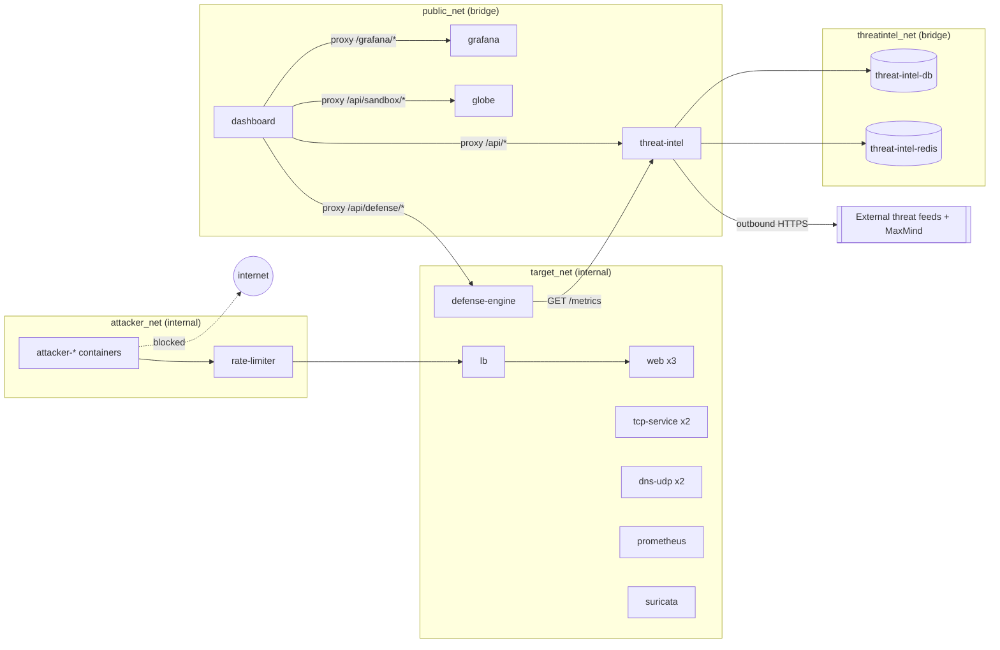
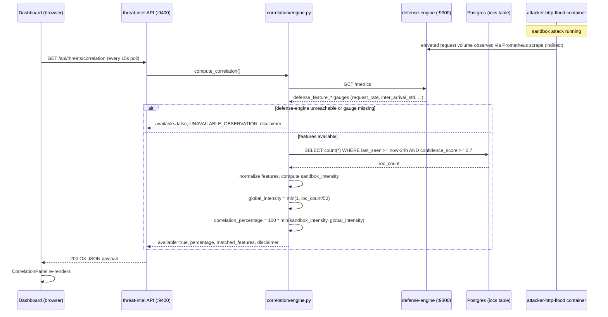
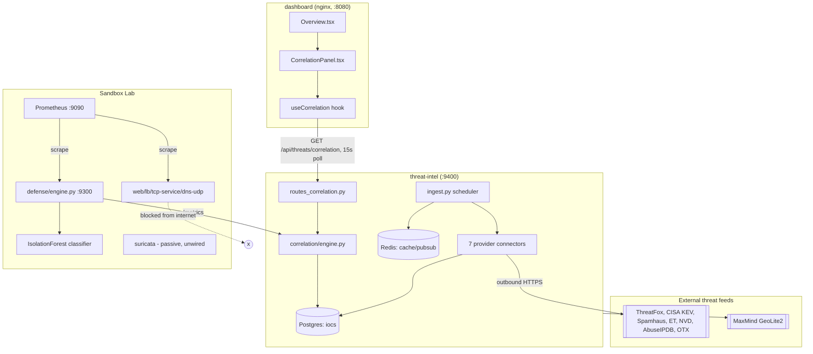

# SENTINEL LAB — Stage I Handoff Document

**Audience:** a senior engineer picking up Stage II with no prior conversation history.
**Status at time of writing:** Stage I (AI-assisted correlation between the Sandbox Lab and the Global Threat Intelligence module) is complete, tested, and verified end-to-end against a live Docker stack.

> **Documentation-sync note (read first):** `PROJECT_EXECUTION_PLAN.md` and `PROJECT_STATE.md` currently mark Stage I as "⬜ Not started." That is stale — the code, tests, and this session's live verification all confirm Stage I is done. Update those two files as part of Stage II kickoff (see [Technical Debt](#technical-debt)); until then, treat this document and the actual code as the source of truth, not the two plan files.

---

## 1. Final Architecture of Stage I

Stage I added exactly one deliberate integration seam between two previously-independent modules:

- **Global Threat Intelligence module** (`services/threat-intel`, Stages A–D): ingests external threat feeds (ThreatFox, CISA KEV, Spamhaus DROP, Emerging Threats, NVD CVE, AbuseIPDB, OTX), stores IOCs/CVEs in Postgres, serves REST + WebSocket APIs, geo-enriches via MaxMind GeoLite2.
- **Sandbox Lab** (`defense/`, `attackers/`, `globe/`, pre-existing): runs simulated DDoS attacks against isolated internal targets, classifies traffic with an IsolationForest model, exposes live behavioral features as Prometheus gauges.

Stage I's job was to answer, heuristically and without ever claiming attribution: *"does the sandbox's current traffic behave anything like what the outside world is currently seeing?"* It does this via one new backend module and one new frontend panel:

- **Backend:** `services/threat-intel/app/correlation/engine.py` — pulls live behavioral features from `defense-engine:9300/metrics` and compares their aggregate intensity against the volume of recent high-confidence IOCs in threat-intel's own database. Exposed via `GET /api/threats/correlation`.
- **Frontend:** `dashboard/src/components/correlation/CorrelationPanel.tsx` — mounted on the Overview page, renders the score, matched features, and a **permanent, unconditional** "heuristic similarity only, not attribution" disclaimer.

Architecturally, this required **no new network attachments** and **no new services**. `threat-intel` already sat on `public_net`; `defense-engine` already sat on `public_net` (plus `target_net`). The correlation engine is a same-origin, read-only HTTP client of `defense-engine`'s existing `/metrics` endpoint — nothing in `defense/engine.py` was modified.

---

## 2. Directory Tree

```
ddos-attack/
├── .claude/launch.json
├── .github/workflows/ci.yml            # lints attackers/defense/globe/reports/tests only — NOT services/threat-intel or dashboard (Stage J gap)
├── PROJECT_EXECUTION_PLAN.md           # stage roadmap — STALE on Stage I status, see note above
├── PROJECT_STATE.md                    # quick-reference stage status — STALE, same note
├── README.md
├── docker-compose.yml                  # single compose file for the entire platform
├── docs/
│   └── HANDOFF_STAGE_I.md              # this document
│
├── attackers/                          # attack simulation containers (profile-gated, never auto-started)
│   ├── Dockerfile, requirements.txt
│   ├── common/{__init__,identity,metrics,recorder}.py
│   ├── http_flood.py, slowloris.py, tcp_exhaustion.py, udp_flood.py, legit_load.py
│   └── replay.py
│
├── dashboard/                          # React SOC dashboard SPA (Vite + TS + Tailwind)
│   ├── Dockerfile, nginx.conf, vite.config.ts, package.json
│   └── src/
│       ├── App.tsx, main.tsx
│       ├── routes/index.tsx
│       ├── layout/{AppShell,Sidebar}.tsx
│       ├── lib/{api,queries,sandboxApi,sandboxStatus,defenseEngineApi,ws}.ts
│       ├── generated/threat-intel.ts   # OpenAPI-generated types — regenerate via `npm run gen:threat-intel`
│       ├── store/threatStore.ts
│       ├── types/threat.ts
│       ├── pages/{Overview,ThreatFeed,SandboxLab,Analytics,Alerts,Settings}.tsx
│       └── components/
│           ├── correlation/CorrelationPanel.tsx      # ★ Stage I
│           ├── feed/{ThreatCard,LiveFeedList,FeedFilters,labels}.tsx
│           ├── globe/{ThreatGlobe,ArcLayer,MarkerLayer,LivePulseLayer,DetailPanel,GlobeFilters,Tooltip,colorScale,constants,earthTexture,geo,useThreatMapData}.tsx
│           ├── sandbox/{AttackControls,GrafanaPanel,MitigationLogTable}.tsx
│           └── ui/{Badge,Button,Card,EmptyState,StatTile,index}.tsx
│
├── defense/                            # detection & mitigation engine (pre-existing, unmodified in Stage I)
│   ├── engine.py                       # FastAPI app, port 9300
│   ├── mitigation_log.jsonl
│   ├── classifier/{features,train,model.joblib}
│   ├── rate_limiter/{Dockerfile,proxy.py}
│   ├── suricata/{suricata.yaml,ddos.rules}
│   └── wazuh/{README.md,ossec_local_rules.xml}  # config stub only — NOT a deployed service, see §9
│
├── globe/                              # sandbox control/visualization API + legacy amCharts globe, port 8090
│   ├── server.py, app.js, index.html
│   └── vendor/
│
├── infra/
│   ├── k8s/*.yaml                      # not deployed in this environment; docker-compose is authoritative
│   └── terraform/main.tf
│
├── live-agent/{agent.py, requirements.txt}
│
├── observability/
│   ├── prometheus/prometheus.yml
│   └── grafana/provisioning/{dashboards,datasources}
│
├── reports/                            # HTML report generator for attack runs
│
├── services/threat-intel/              # Global Threat Intelligence backend (Stages A–I)
│   ├── app/
│   │   ├── main.py, settings.py, logging_config.py
│   │   ├── ingest.py, enrich.py, geoip_updater.py, geo_fallback.py  # geo_fallback built but unwired
│   │   ├── common/{schema,models,db,dedup,cache,geoip,geo_cache}.py
│   │   ├── provider/{base,http,threatfox,cisa_kev,spamhaus_drop,emerging_threats,nvd_cve,abuseipdb,otx}.py
│   │   ├── api/{routes_threats,routes_providers,routes_geoip,routes_ws,routes_correlation}.py  # ★ routes_correlation.py is Stage I
│   │   └── correlation/engine.py       # ★ Stage I
│   └── tests/
│       ├── test_correlation.py         # ★ Stage I, 8 tests
│       ├── test_enrich.py, test_geoip.py, test_geoip_updater.py, test_providers.py
│       └── fixtures/*.mmdb
│
├── targets/                            # synthetic attack targets: web/, lb/, tcp_service/, dns_udp/
│
└── tests/
    ├── isolation-attacker.Dockerfile
    ├── test_classifier.py
    └── test_network_isolation.sh       # THE empirical isolation proof — must pass before trusting any attacker/target service
```

---

## 3. Every Component Added During Stage I

| Component | Path | Purpose |
|---|---|---|
| Correlation engine | `services/threat-intel/app/correlation/engine.py` | Computes the heuristic behavioral-similarity score. See §11. |
| Correlation route | `services/threat-intel/app/api/routes_correlation.py` | Exposes `GET /api/threats/correlation`. |
| Route wiring | `services/threat-intel/app/main.py` | Includes the new router; endpoint listed alongside the others at `/`. |
| Settings additions | `services/threat-intel/app/settings.py` | `DEFENSE_ENGINE_METRICS_URL`, `CORRELATION_MIN_CONFIDENCE`, `CORRELATION_WINDOW_HOURS`. |
| Backend tests | `services/threat-intel/tests/test_correlation.py` | 8 tests — unreachability, partial-gauge-missing, zero-IOC edge case, no-attribution structural guard. |
| Frontend panel | `dashboard/src/components/correlation/CorrelationPanel.tsx` | Renders score/observation/matched-features/disclaimer with loading/error/unavailable/success states. |
| Frontend hook | `dashboard/src/lib/queries.ts` (`useCorrelation`) | React-query wrapper, 15s poll interval, `retry: 0` (engine degrades gracefully rather than erroring). |
| Overview integration | `dashboard/src/pages/Overview.tsx` | Mounts `<CorrelationPanel/>`. |
| Type additions | `dashboard/src/types/threat.ts` | Correlation response shape (also present in generated OpenAPI types). |
| Regenerated OpenAPI client | `dashboard/src/generated/threat-intel.ts` | Regenerated this session via `npm run gen:threat-intel` against the live running `threat-intel` container so `/api/threats/correlation` is now a typed path. |

No changes were made to `defense/engine.py`, `docker-compose.yml` networking, or any Sandbox Lab attacker/target code — Stage I is additive-only on the threat-intel and dashboard sides.

---

## 4. APIs Introduced

### `GET /api/threats/correlation` (threat-intel, port 9400)

No query parameters. Always returns HTTP 200 (never errors — unreachable dependencies degrade the payload, they don't fail the request).

```json
{
  "available": true,
  "correlation_percentage": 27.34,
  "observation": "Current sandbox traffic shows 27% behavioral-intensity similarity to 1677 recently observed high-confidence threat indicators, driven by elevated inter_arrival_std.",
  "matched_features": ["inter_arrival_std"],
  "disclaimer": "Heuristic behavioral similarity only. This is not attribution: it does not identify any actor, malware family, campaign, or specific indicator as the source of current sandbox traffic.",
  "compared_ioc_count": 1677,
  "generated_at": "2026-07-18T21:06:01.894542+00:00"
}
```

Degraded response (`defense-engine` unreachable, or any of its 5 required gauges missing):

```json
{
  "available": false,
  "correlation_percentage": null,
  "observation": "Correlation unavailable: sandbox telemetry (defense-engine) could not be reached.",
  "matched_features": [],
  "disclaimer": "Heuristic behavioral similarity only. This is not attribution: it does not identify any actor, malware family, campaign, or specific indicator as the source of current sandbox traffic.",
  "compared_ioc_count": 1677,
  "generated_at": "2026-07-18T21:04:22.426106+00:00"
}
```

The `disclaimer` field is present and identical in **every** response, available or not — this is a structural safety requirement, verified by `test_correlation_never_mentions_attribution_terms`.

Pre-existing threat-intel endpoints (unchanged by Stage I, listed for completeness): `GET /`, `GET /health`, `GET /api/threats/{live,map,countries,types,timeline,search,stats}`, `GET /api/providers/status`, `GET /api/geoip/status`, `WS /ws/threats`.

Pre-existing defense-engine endpoints consumed by the correlation engine (unchanged): `GET /metrics` (Prometheus exposition format — the correlation engine parses this with a minimal regex-based parser, not a real Prometheus client library).

---

## 5. Data Flow

### Correlation computation (per request to `GET /api/threats/correlation`)

1. threat-intel's route handler calls `compute_correlation()` in `correlation/engine.py`.
2. `fetch_sandbox_features()` issues `GET http://defense-engine:9300/metrics` (same-origin on `public_net`, ~seconds-scale latency).
3. The text response is parsed for exactly 5 gauges: `defense_feature_request_rate`, `defense_feature_avg_connection_duration`, `defense_feature_inter_arrival_std`, `defense_feature_error_rate`, `defense_feature_active_connections`. If the HTTP call fails or any single gauge is absent, the function returns `None` (all-or-nothing — no partial signal is ever used).
4. In parallel (or sequentially — no dependency), a DB query counts IOCs where `last_seen >= now - CORRELATION_WINDOW_HOURS` (24h) and `confidence_score >= CORRELATION_MIN_CONFIDENCE` (0.7).
5. If sandbox features are `None` → return the degraded payload immediately.
6. Otherwise: normalize each of the 5 features to `[0,1]`, average them into `sandbox_intensity`, compute `global_intensity = min(1, ioc_count / 50)`, and take `correlation_percentage = 100 * min(sandbox_intensity, global_intensity)`.
7. Build a fixed-template observation string naming only numbers and feature names (never an IOC value, IP, or actor name).
8. Return the payload.

### End-to-end flow verified live this session

```
sandbox attack starts (attackers/http_flood.py container)
  → targets (web/lb) see elevated request rate
  → Prometheus scrapes target + defense-engine gauges every 5s
  → defense/engine.py's detection_loop recomputes features + IsolationForest score every 5s, exposes via /metrics
  → threat-intel's correlation engine polls /metrics on each API call
  → GET /api/threats/correlation returns updated percentage/matched_features
  → dashboard's useCorrelation (15s poll) picks up the new value
  → CorrelationPanel re-renders
```

This was exercised directly: starting `http-flood` produced `inter_arrival_std` as a matched feature and a `27.34%` score within ~15 seconds; stopping it returned the score toward `0%`.

---

## 6. Docker Architecture

18 services total when the full stack (`docker compose up -d`, no profiles) is running:

| Service | Purpose | Key ports |
|---|---|---|
| `web` (×3), `lb`, `tcp-service` (×2), `dns-udp` (×2) | Synthetic attack targets | internal only |
| `prometheus` | Scrapes all target + defense-engine + rate-limiter metrics | `9090:9090` |
| `defense-engine` | Feature extraction + IsolationForest classifier + adaptive rate-limit threshold | `9300:9300` |
| `rate-limiter` | Reverse proxy enforcing the threshold `defense-engine` computes | internal only |
| `suricata` | IDS, shares `rate-limiter`'s netns | passive, no exposed port |
| `grafana` | Dashboards over Prometheus | `3000:3000` |
| `globe` | Sandbox attack start/stop control API + legacy visualization | `8090:8090` |
| `threat-intel-db` (Postgres 16), `threat-intel-redis` (Redis 7) | threat-intel's storage | internal only |
| `threat-intel` | Global Threat Intelligence API + **correlation engine** | `9400:9400` |
| `dashboard` | React SOC SPA, nginx-served, reverse-proxies to the above | `8080:8080` |

Attacker containers (`attacker-http-flood`, `attacker-slowloris`, `attacker-udp-flood`, `attacker-tcp-exhaustion`, `legit-load`) and the isolation-test fixtures (`isolation-target`, `isolation-attacker`) are **profile-gated** and not part of a default `up`. They are started dynamically by `globe/server.py` shelling out to `docker compose --profile <name> up -d <service>` via a mounted `docker.sock`.

Named volumes: `suricata-logs`, `threat-intel-db-data`, `threat-intel-geoip`.

---

## 7. Networking Architecture

Four Docker networks, defined at the top of `docker-compose.yml`:

- **`attacker_net`** (`internal: true`) — attacker containers + `rate-limiter`. No route out of the Docker host at all (kernel-level, not app-layer).
- **`target_net`** (`internal: true`) — targets, prometheus, suricata (via rate-limiter's netns), defense-engine.
- **`public_net`** (bridge, NOT internal) — operator-facing services: `grafana`, `globe`, `dashboard`, `threat-intel`, `defense-engine` (dual-homed), `prometheus` (dual-homed).
- **`threatintel_net`** (bridge, NOT internal, Stage D) — `threat-intel`, `threat-intel-db`, `threat-intel-redis` only. Isolated from `attacker_net`/`target_net`; `threat-intel` needs outbound HTTPS for its feed providers and MaxMind, so this network is deliberately not `internal`.

**Reachability rules:**
- Attacker ↔ target: reachable (shared `target_net`).
- Attacker/target → internet: **blocked**, proven live by `tests/test_network_isolation.sh` this session (5/5 assertions passed: internal reachability OK, raw-IP HTTPS blocked ×2, DNS resolution blocked, ICMP blocked).
- `threat-intel` → internet: allowed (outbound only, to fetch feeds), never reachable from `attacker_net`/`target_net`.
- `dashboard` → `public_net` only; never touches attacker/target nets.
- `defense-engine` is the **one** dual-homed service (`target_net` + `public_net`), which is what makes it reachable by `threat-intel`'s correlation engine and the dashboard's proxy — this is the sole intentional cross-module seam, and it's read-only (`GET /metrics`).



---

## 8. Prometheus / Grafana Integration

**`observability/prometheus/prometheus.yml`** — 5s scrape/eval interval. Jobs:

| Job | Discovery | Port | Path |
|---|---|---|---|
| `target-web` | DNS SD on `web` | 8000 | `/metrics` |
| `target-tcp` | DNS SD on `tcp-service` | 9100 | `/metrics` |
| `target-udp` | DNS SD on `dns-udp` | 9200 | `/metrics` |
| `defense-engine` | static | 9300 | `/metrics` |
| `rate-limiter` | static | 8080 | `/metrics` |
| `prometheus` | self | 9090 | `/metrics` |

Verified live this session: `curl http://localhost:9090/api/v1/targets` shows all 10 active targets (across replicas) reporting `health: up`.

**Grafana** — provisioned automatically (no manual dashboard import needed): one datasource (`Prometheus`, `http://prometheus:9090`, default, non-editable) and one dashboard (`sentinel-overview.json`, file-provisioned, 10s auto-refresh). Anonymous viewer access and iframe embedding are enabled (`GF_AUTH_ANONYMOUS_ENABLED=true`, `GF_SECURITY_ALLOW_EMBEDDING=true`, `GF_SECURITY_COOKIE_SAMESITE=disabled`) so the dashboard's `SandboxLab.tsx` can iframe it directly via `components/sandbox/GrafanaPanel.tsx`. Verified live this session: `GET /api/health` → `{"database":"ok"}`.

**Note:** the correlation engine does **not** query Prometheus directly — it queries `defense-engine`'s own `/metrics` endpoint, which is the same data Prometheus scrapes, but fetched fresh on each correlation request rather than via PromQL. This avoids adding a Prometheus HTTP API dependency to threat-intel.

---

## 9. Suricata / Wazuh Integration (Current State)

**Suricata: running, but standalone/passive.**
- Real service in `docker-compose.yml`: image `jasonish/suricata:7.0.3`, `network_mode: service:rate-limiter` (shares the rate-limiter's network namespace, so it sits at the actual traffic chokepoint for `http-flood`/`slowloris` runs), watches interface `eth0`, config at `defense/suricata/suricata.yaml`.
- Custom rules in `defense/suricata/ddos.rules`: sid 1000001 (HTTP flood, >200 conns/10s to 8000/8080), sid 1000002 (Slowloris, SYN threshold 50/10s), sid 1000003 (UDP flood, >500/10s to port 5300), sid 1000004 (TCP exhaustion, SYN threshold 200/10s to port 9000).
- Logs EVE JSON (`alert`, `flow`, `stats`, `dns`, `tcp` event types) to the named `suricata-logs` volume.
- **Nothing downstream reads it.** `defense-engine` doesn't ingest Suricata alerts; `threat-intel`'s correlation engine doesn't either; the dashboard has no Suricata panel. It's fully functional as an IDS but its output currently goes nowhere.

**Wazuh: not deployed — documentation/config stub only.**
- Grep for "wazuh" across the repo hits only `README.md`, `PROJECT_EXECUTION_PLAN.md`, `defense/wazuh/README.md`, and `defense/wazuh/ossec_local_rules.xml`.
- **No `wazuh` service exists anywhere in `docker-compose.yml`.**
- `defense/wazuh/README.md` explicitly self-describes as "a working configuration stub rather than a fully managed Wazuh cluster" — the decoder/rule XML for correlating Suricata EVE alerts + `defense/mitigation_log.jsonl` is written, but there is no Wazuh manager container to consume it.
- **This is a genuine gap between documentation and running infrastructure.** Flag it explicitly in Stage II scoping rather than assuming Wazuh is "mostly done."

---

## 10. Correlation Engine Design

**File:** `services/threat-intel/app/correlation/engine.py`

**Design goal:** produce a single, bounded, non-attributive "how similar does current sandbox behavior look to what the outside threat-intel feeds are currently showing" signal, with hard guarantees that it never fails the request and never fabricates specificity it doesn't have.

**Inputs:**
1. Five behavioral feature gauges scraped live from `defense-engine:9300/metrics`: `request_rate`, `avg_connection_duration`, `inter_arrival_std`, `error_rate`, `active_connections`. These are the exact same five features `defense/classifier/features.py`'s `FEATURE_NAMES` computes for the IsolationForest classifier — Stage I reuses them rather than defining new ones.
2. A count of "recent high-confidence" IOCs from threat-intel's own Postgres: `last_seen >= now - CORRELATION_WINDOW_HOURS` (default 24h) AND `confidence_score >= CORRELATION_MIN_CONFIDENCE` (default 0.7).

**Algorithm:**
1. **Fetch & parse** (`fetch_sandbox_features`): `GET /metrics`, parse with a minimal regex-based Prometheus text parser (no external client library dependency). Returns `None` on connection failure or if any of the 5 required gauges is absent — deliberately all-or-nothing, no partial-signal interpolation.
2. **Normalize** (`_normalize_feature`): each raw feature value is scaled to `[0, 1]` against a fixed reference max (`request_rate: 300`, `avg_connection_duration: 2.0`, `error_rate: 1.0`, `active_connections: 500`). `inter_arrival_std` is special-cased as `1.0 - normalized_value`, since a *smaller* inter-arrival gap (tighter, more machine-like request timing) is the anomalous direction.
3. **Sandbox intensity:** mean of the 5 normalized values. Any feature whose normalized value is `>= 0.5` (`NOTABLE_FEATURE_THRESHOLD`) is added to `matched_features`.
4. **Global intensity:** `min(1, ioc_count / 50)` (`IOC_VOLUME_REFERENCE`) — a simple volume proxy for "how much is currently happening in the outside threat landscape," capped at 1.0 once 50+ high-confidence IOCs are in the recent window.
5. **Correlation percentage:** `round(100 * min(sandbox_intensity, global_intensity), 2)`. Using `min` rather than a product or average is deliberate: the score represents *agreement in magnitude* between two independently-measured signals, not a joint probability — if either signal is quiet, the score stays low regardless of the other.
6. **Observation string** (`_build_observation`): a fixed template interpolating only the percentage and (if any) the top matched feature name. It is structurally incapable of naming an IP, actor, campaign, or malware family, because no such data is ever passed into the format string.
7. **Disclaimer:** a module-level constant string, always attached to every response, available or not.

**Failure/degradation behavior:** any failure to reach `defense-engine`, or any missing gauge, produces `available=False` with a fixed `UNAVAILABLE_OBSERVATION` string — the function never raises, and the FastAPI route never returns anything other than HTTP 200. This was verified live this session by stopping the `defense-engine` container and confirming the endpoint degraded correctly, then recovering once it restarted.

**Test coverage** (`services/threat-intel/tests/test_correlation.py`, 8 tests, all passing):
1. Prometheus text parser handles comments/gauges correctly.
2. Happy-path gauge parsing (all 5 present).
3. Returns `None` on `ConnectError`.
4. Returns `None` when even one gauge is missing (all-or-nothing).
5. Full degrade path when defense-engine is down.
6. Happy-path percentage/matched-features computation.
7. **Structural no-attribution guard**: scans the generated observation string for `["actor", "campaign", "malware family", "botnet", "attacker is", "attributed to"]` and asserts none appear.
8. `correlation_percentage == 0.0` when `ioc_count == 0`, regardless of sandbox intensity (the `min()` formula means zero global signal always zeroes the result).

---

## 11. Remaining Stage II Dependencies

Per the project's own `PROJECT_EXECUTION_PLAN.md` roadmap (Stage J, "Docs and CI"), confirmed genuinely unstarted by reading `.github/workflows/ci.yml`:

1. **CI extension** — the CI pipeline (`lint` job) currently only runs `ruff` over `attackers defense globe reports tests`. It does **not** lint, type-check, or test `services/threat-intel` or `dashboard`. This session ran `ruff check`, `mypy --ignore-missing-imports`, `pytest`, `npm run typecheck`, `npm run lint`, and `npm run build` manually — none of that is wired into CI yet.
2. **`README.md` updates** — needs a "Module 2" section describing the Global Threat Intelligence service, plus a Logical vs. Physical Architecture table reflecting the current 4-network topology.
3. **New `docs/threat-intel.md`** — dedicated reference doc for providers, DB schema, confidence formula, correlation disclaimer text, and the full env var list (currently only documented inline in `settings.py` and this handoff doc).
4. **`PROJECT_EXECUTION_PLAN.md` / `PROJECT_STATE.md` sync** — mark Stage I as complete (see the note at the top of this document).

Beyond the plan's own Stage J, genuine open items surfaced by this session's verification:

5. **Suricata → downstream integration** — currently a fully passive IDS whose EVE JSON output nothing consumes. If Stage II wants richer detection signal, either wire Suricata alerts into `defense-engine`'s feature set or into `threat-intel`'s correlation engine as a third input.
6. **Wazuh** — decide whether to actually deploy a Wazuh manager container consuming the existing `defense/wazuh/ossec_local_rules.xml` stub, or remove/relabel it as aspirational-only in docs to avoid future confusion.
7. **`geo_fallback.py`** — built in Stage C.5 but never wired into any endpoint. Needs a UX decision (silent fallback vs. explicit "approximate location" flag in the API response) before enabling.

---

## 12. Technical Debt

| Item | Location | Detail |
|---|---|---|
| No Alembic / schema migrations | `services/threat-intel/app/common/db.py` | Schema is `Base.metadata.create_all()` only — creates missing tables, never `ALTER`s existing ones. Any future column change to `Ioc`/`IocSighting`/`Cve` requires a manual migration story before Stage II adds fields. |
| Plan docs out of sync with code | `PROJECT_EXECUTION_PLAN.md`, `PROJECT_STATE.md` | Both mark Stage I "Not started." Update before Stage II work begins so future sessions don't re-derive this. |
| CI doesn't cover new code | `.github/workflows/ci.yml` | See §11 item 1. |
| Suricata output unconsumed | `defense/suricata/`, named volume `suricata-logs` | Running IDS with no downstream consumer — either wire it in or note it as intentionally deferred. |
| Wazuh stub, not a running service | `defense/wazuh/` | Config/decoder XML exists with no manager container. Docs (`README.md`) may overstate its status — verify before citing it as "integrated." |
| Bundle size warning | `dashboard` build output | Main JS chunk is ~1.7 MB (493 KB gzip) — Vite warns about chunks >500 KB. Not blocking, but code-splitting (dynamic `import()` for the 3D globe / recharts) would help before Stage II adds more UI weight. |
| Stale attacker containers can block sandbox runs | `attackers/*` compose profiles | Encountered live this session: a leftover `attacker-http-flood` container from a prior session referenced a since-recreated Docker network ID and caused `POST /api/sandbox/attacks/http-flood/start` to fail with a networking error until manually `docker rm -f`'d. `globe/server.py`'s start logic doesn't currently detect/clean up this state itself — worth a defensive fix (`docker rm` before `up` on start) if this recurs. |
| Correlation engine uses regex Prometheus parsing, not a client library | `services/threat-intel/app/correlation/engine.py` | Works fine for the current 5-gauge exposition format; would need hardening if `defense-engine`'s `/metrics` output format grows more complex (histograms, labels). |
| No precision/recall/FPR metrics anywhere | `dashboard/src/pages/Analytics.tsx` | Explicitly and deliberately omitted per Stage G notes since neither backend computes them — flagged here so Stage II doesn't assume they exist. |

---

## 13. Future Improvements

- **Third correlation input:** feed Suricata alert counts/types into the correlation engine as a third signal alongside sandbox features and IOC volume, once Suricata is wired downstream (see §11 item 5).
- **Historical correlation trend:** currently the correlation score is point-in-time only (each request recomputes fresh). A time-series of correlation scores (stored, e.g., in Redis with a TTL or a lightweight table) would let `Analytics.tsx` chart it over an attack run rather than showing only the latest value.
- **Configurable reference constants:** `_FEATURE_REFERENCE_MAX`, `NOTABLE_FEATURE_THRESHOLD`, `IOC_VOLUME_REFERENCE` are currently hardcoded module constants. Moving them to `settings.py` (like `CORRELATION_MIN_CONFIDENCE` already is) would make the heuristic tunable without a code change.
- **Alembic migration story** — before Stage II touches the DB schema, worth setting up Alembic to avoid destructive `create_all()`-only drift.
- **CI parity** — extend `.github/workflows/ci.yml` to lint/typecheck/test both `services/threat-intel` and `dashboard` (Stage J, already planned).
- **Dashboard code-splitting** — dynamic-import the globe (`react-three-fiber`) and `recharts` bundles to shrink the initial JS payload.

---

## 14. Known Limitations

- The correlation score is a **heuristic magnitude-agreement signal between two independently-measured aggregates**, not a per-IOC match, not ML-based, and not attribution. This is by design (see the disclaimer text and the structural test guarding against attribution language), but it means the number should never be presented to an end user as "X% confidence this is threat family Y" — it structurally cannot support that claim.
- `defense-engine`'s `/metrics` must expose all 5 specific gauge names for correlation to report `available: true`. If the classifier or feature set is ever refactored, the correlation engine's gauge names must be updated in lockstep, or it will silently and correctly degrade to `available: false` (silent from the caller's perspective — no error is raised, just a degraded payload, per the graceful-degradation-by-design contract).
- The IOC volume reference (`50` for global intensity to hit 1.0) is an arbitrary constant, not calibrated against any real-world baseline. Treat percentages as relative/comparative, not absolute.
- Suricata is running and generating real alert data (EVE JSON) that is currently unused — don't assume it's informing any detection or correlation logic today.
- No Wazuh manager is deployed despite `defense/wazuh/` config files existing — don't cite Wazuh as "integrated" without first deploying it.
- `k8s/` and `terraform/` manifests exist under `infra/` but this entire lab runs via `docker-compose.yml` in the verified environment — treat the IaC manifests as unverified/aspirational unless you confirm otherwise.

---

## 15. Sequence Diagram — Correlation Request (Live, Attack in Progress)



---

## 16. Component Interaction Diagram



---

## 17. Stage II Implementation Roadmap

This is a suggested sequencing based on the plan's own Stage J scope plus the gaps this handoff surfaced. Adjust priority per the senior engineer's judgment — nothing here is a hard dependency of anything else except item 1.

1. **Doc sync (do first, low effort, unblocks trust in the plan docs going forward):**
   - Update `PROJECT_EXECUTION_PLAN.md` and `PROJECT_STATE.md` to mark Stage I complete.
   - Add this handoff document's content (or a link to it) into the plan's stage history.

2. **CI parity (Stage J core):**
   - Add `services/threat-intel` to the `lint` job (`ruff check`, `mypy --ignore-missing-imports`).
   - Add a `threat-intel-tests` job (`pytest` — needs Postgres/Redis service containers in CI, mirroring `docker-compose.yml`'s health-checked dependency pattern).
   - Add a `dashboard` job (`npm run typecheck`, `npm run lint`, `npm run build`).

3. **Docs (Stage J core):**
   - `README.md`: add "Module 2 — Global Threat Intelligence" section + updated architecture table (4 networks, not 2).
   - New `docs/threat-intel.md`: providers, schema, confidence formula, correlation formula/disclaimer, full env var reference (pull from `settings.py` + this handoff's §4/§11).

4. **Decide Suricata/Wazuh scope for Stage II:**
   - Either wire Suricata EVE alerts into `defense-engine` (new feature source) or `threat-intel`'s correlation engine (third input, per §13), or explicitly document them as out-of-scope/future in `README.md` so the docs stop overstating their integration.
   - Wazuh: deploy a manager container consuming `defense/wazuh/ossec_local_rules.xml`, or relabel the directory as a stub in docs — don't leave it ambiguous.

5. **Alembic migration setup:**
   - Before any Stage II schema change to `Ioc`/`IocSighting`/`Cve`, add Alembic so `create_all()`-only drift doesn't become a production-breaking gap.

6. **Correlation engine hardening (optional, based on Stage II's actual feature asks):**
   - Move hardcoded reference constants (`_FEATURE_REFERENCE_MAX`, `NOTABLE_FEATURE_THRESHOLD`, `IOC_VOLUME_REFERENCE`) into `settings.py`.
   - Add a historical correlation trend (time-series storage + chart in `Analytics.tsx`) if Stage II wants attack-run-level correlation visualization rather than point-in-time only.

7. **Frontend polish (only if Stage II's scope includes it):**
   - Dashboard bundle code-splitting (globe + recharts as dynamic imports) to address the 1.7 MB chunk warning before adding more UI.

8. **Defensive fix for sandbox attack start (small, opportunistic):**
   - `globe/server.py`'s attack-start logic should `docker rm -f` any stale container with the same name before `up`, to avoid the stale-network-ID failure mode encountered this session.

---

*This document reflects the state of the repository as verified live against a running Docker stack in this session (all 18 core services healthy, 36/36 backend tests passing, network isolation test 5/5 assertions passing, end-to-end correlation flow exercised with a live `http-flood` sandbox run).*
